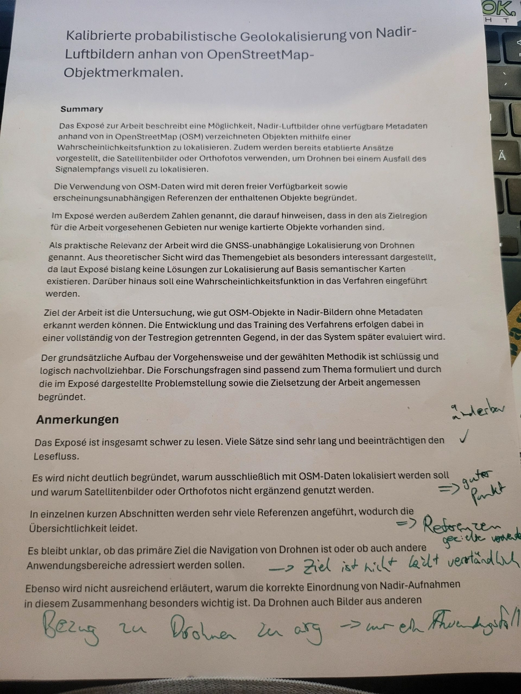
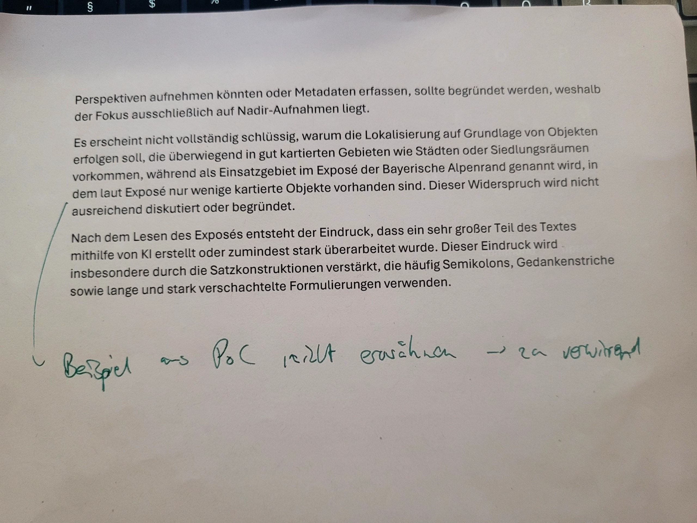

A fellow student's peer review of the exposé draft of 22.10.2026. It finds the method coherent and the research questions fitting, but criticises readability, citation density, an unclear primary goal (drones or more), the unexplained nadir and OSM-only choices, and an apparent contradiction between object-based localisation and the sparse Alpine edge; the author's handwritten notes accept most points.

## Summary
The review comes from the course's peer-review round ([[wa-course-expose]]) and is stored as two photos (, ) plus a verbatim transcription. The reviewed PDF is byte-identical to `expose/expose-ki-entwurf.pdf` (commit 411def2). The reviewer is not named. It has a *Summary* (what the exposé says, overall verdict) and seven *Anmerkungen* (A1–A7). The author annotated them in green pen; those notes are the author's own position.

## Key claims
- **Overall verdict:** the structure of the procedure and the method is "schlüssig und logisch nachvollziehbar"; the research questions fit the topic and are justified by the problem statement and goals ([[peer-review-expose]]).
- **A1 readability:** hard to read, many very long sentences. Author: "änderbar ✓". On pages 1–3 the median sentence has 24.5 words, the longest 59 (count by the assistant on the PDF).
- **A2 OSM only:** no clear reason why localisation uses OSM only and not satellite images or orthophotos in addition. Author: "guter Punkt". The draft gives one sentence (S. 1: OSM is "eine frei verfügbare, weniger erscheinungsabhängige Referenz").
- **A3 citation density:** many references in short sections. Author: "Referenzen gezielter verwenden". S. 1 has 7 citations in 4 sentences (paragraph 1) and 8 in 4 (paragraph 2).
- **A4 primary goal:** unclear whether drone navigation is the main goal or other applications too. Author: "Ziel ist nicht leicht verständlich".
- **A5 why nadir:** drones could capture other perspectives or metadata, so the nadir-only focus needs a reason. Author: "Bezug zu Drohnen zu arg → nur ein Anwendungsfall".
- **A6 contradiction:** localisation rests on objects found mostly in well-mapped settlements, yet the Alpine edge, where the exposé reports few mapped objects, is named as the area. Author: "Beispiel aus PoC nicht erwähnen → zu verwirrend", i.e. drop the pre-test example.
- **A7 style impression:** the reviewer suspects heavy AI generation or revision because of frequent semicolons, dashes and long nested sentences. No author note. The draft has 13 semicolons and 2 dashes on pages 1–3 (count by the assistant).
- **Misreadings in the reviewer's summary** (they show where the draft is unclear):
  - "bislang keine Lösungen zur Lokalisierung auf Basis semantischer Karten": the draft says the opposite; the parts exist, including ambiguity rejection on semantic maps (SASGeo), and only their combination was not found ([[author-note-novelty]]).
  - "Ziel … wie gut OSM-Objekte … erkannt werden können": that is FF1 only; the main question, localisation with calibration, did not come across.
  - "erscheinungsunabhängig": the draft says "weniger erscheinungsabhängig".

## Relevance to this wiki
- It overlaps with the strict review in [[expose-review]]: A2 ↔ #8 (an orthophoto comparison would be circular, because test image and reference come from the same DOP20), A4/A5 ↔ #2b (drone framing vs orthophoto tests), A6 ↔ #3 and #10 (pre-test numbers and coverage).
- New compared with that review: readability and sentence length (A1), citation density (A3), the missing reason for nadir and "ohne Metadaten" (A5), and the style impression (A7).
- The author's notes set two directions: drones are **one use case among several**, not the framing ([[gnss-denied-use-cases]]), and the **pre-test example leaves the exposé**. This matches the scope decision that the thesis is not limited to feature-poor regions ([[author-decision-framework-scope]]).
- Fixes per point are in [[expose-revision]].

## Pages touched
[[expose-revision]], [[expose-review]], [[expose-guide]], [[gnss-denied-use-cases]], [[author-decision-nadir-input]], [[overview]]

## Related
- [[expose-review]]
- [[expose-revision]]
- [[wa-course-expose]]
- [[author-decision-framework-scope]]
- [[gnss-denied-use-cases]]
