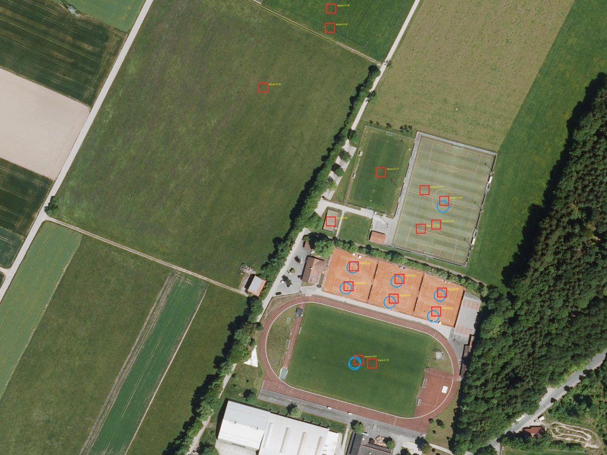

The first fully real test of the pipeline: real Bavarian DOP20 photos without metadata, an off-the-shelf DOTA detector and the real OSM export. It locates 6/40 photos near anchors and 0/40 random photos, and it produced the first **wrong "confident" match**, caused by a repetitive tank farm.

## Summary
Run with `tools/real_geo_test.py` on 40 sites placed near OSM objects ("anchor", optimistic) and 40 placed uniformly
("uniform", honest). Each photo is a real DOP20 crop, 500 × 375 m at 0.2 m, randomly rotated. The detector is YOLO11s-OBB
pretrained on DOTA, not fine-tuned; the classes are pool, tank, soccer, track and court (tennis, basketball and baseball merged).
Only the test script knows the true pose. Example: 
(blue = OSM objects, red = detections; DOP20 © Bayerische Vermessungsverwaltung, CC BY 4.0).

## Key claims
- **Detection, anchor sites:** precision 0.49 and recall 0.62 against OSM (313 detections, 239 OSM objects). Precision is a lower bound, because some false alarms are real but unmapped objects ([[real-e2e-test]]).
- **No match attempt** at 18/40 anchor sites: 14 of them had zero detections although 1–6 OSM objects were in the photo. Small pools and some courts are missed ([[real-e2e-test]]).
- **Localisation, anchor sites:** correct (< 50 m) **6/40 = 15 %**. Status accuracy:
  - confident: 3/4 correct;
  - probable: 2/4;
  - ambiguous: 1/14.
  - Correct matches: 0.9–5.2 m position error, 0.35–2.35 % scale error, 0.9–2.9° heading error ([[real-e2e-test]]).
- **A wrong confident match (site 17):** a tank farm with 44 mapped tanks matched the region's densest tank cluster, 63.5 km away, at a 76 % wrong scale with 68 inliers. Dense, repetitive single-class clusters break the uniqueness argument, which assumes independently placed objects ([[real-e2e-test]]).
- **Uniform sites:** 36/40 photos contain no anchor of these classes; **0/40 located**. This confirms the 1 % found with simulated detections ([[real-e2e-test]], [[osm-real-test]]).
- **Speed:** about 8 s per 500 × 375 m photo on CPU, including the WMS download ([[real-e2e-test]]).

> [!warning] Contradiction
> [[osm-real-test]] (simulated detections on the real layout) found **confident 30/30 correct**. This real end-to-end run found
> **confident 3/4 correct**: the false one is a repetitive single-class cluster with many false-positive detections, a case the
> simulation (random false alarms, perfect classes) did not produce. The newer, real result is taken as the binding one; the confident rule needs fixing.

## Relevance to this wiki
This is the first measurement for FF1 (detection) and the first end-to-end number for FF2. It shows three things:
1. An off-the-shelf DOTA model is a weak FF1 baseline (recall about 0.6, misses small pools), so fine-tuning on OSM/ALKIS labels is needed ([[pretrained-models]]).
2. The confidence rule needs a **density-aware significance test** or a **class-diversity requirement** (proposal, unsourced).
3. Point anchors cannot cover random photos, so buildings, terrain and dense registration remain necessary ([[feasibility]], [[coarse-to-fine-localization]]).

## Pages touched
[[geo-match-prototype]], [[feasibility]], [[osm-real-test]], [[pretrained-models]], [[overview]]

> [!note] Follow-up
> After the class-diversity rule, the rerun of the same 40 anchor sites gives confident 2/2 correct ([[localization-levers-test]]).

## Related
- [[localization-levers-test]]
- [[osm-real-test]]
- [[geo-match-prototype]]
- [[feasibility]]
- [[object-detection]]
- [[ransac]]
