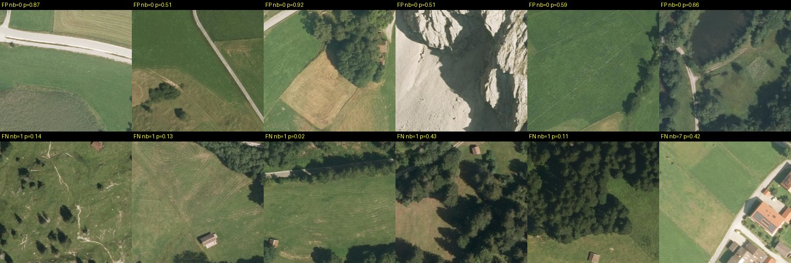

A real-data test of whether 1-ha DOP20 cells containing buildings or settlements can be recognised stably. A linear model on pretrained DOTA features, trained in Miesbach, separates settlement cells in Garmisch-Partenkirchen with AUC 0.98–0.995, and the result barely changes on the 2018 flight.

## Summary
1,100 cells of 100 × 100 m were sampled in Miesbach and Garmisch-Partenkirchen: per district, 400 uniformly and 150 near buildings. Each cell was labelled from OSM
building centroids, either "built" (≥ 1 building) or "settlement" (≥ 5). It was classified from either colour and texture statistics or a 512-d embedding of the DOTA-pretrained
YOLO11s-OBB, using logistic regression. Stability was tested in three ways: spatial block cross-validation, transfer to the other district, and transfer to a flight six years older.
Script: `tools/settlement_test.py`. Errors: 

## Key claims
- **Settlement (≥ 5 buildings/ha), DOTA embedding:** AUC 0.985 with spatial CV in Miesbach, 0.982 on Garmisch (all cells), **0.995 [0.983, 1.0] on uniform Garmisch cells**, and **0.984 [0.968, 0.995] on Garmisch with the 2018 flight**. F1 is 0.89 / 0.91 on all Garmisch cells for 2024 / 2018 ([[settlement-test]]).
- **Built (≥ 1 building/ha):** harder. AUC 0.965 [0.939, 0.986] on uniform Garmisch cells (embedding) and 0.898 with colour/texture; F1 0.76 on uniform cells ([[settlement-test]]).
- **Temporal stability:** a model trained on 2024 loses ≤ 0.016 AUC on the 2018 flight. Same-cell predictions agree 92.5–95.5 % between the flights, and part of the disagreement is real change ([[settlement-test]]).
- **Spatial transfer:** moving from Miesbach (pre-Alpine, hilly) to Garmisch (high Alpine) costs ≤ 0.004 AUC for settlement with embeddings, and 0.01–0.07 with colour/texture ([[settlement-test]]).
- **Pretrained features beat hand-crafted ones**, mainly under transfer: built, uniform Garmisch: 0.965 vs 0.898 ([[settlement-test]]).
- **At real prevalence, precision is the weak point:** settlements cover only 2–4 % of uniform cells. With the default threshold, precision is 0.44 at recall 0.89 (9 positives, so very uncertain). Choose the threshold for the use case ([[settlement-test]]).
- **Misses are isolated huts and hay barns:** 10 of 11 missed "built" cells hold exactly one OSM building, mostly a 5–10 m barn in a meadow. **False alarms** are roads, mown field patterns, bare rock and ponds ([[settlement-test]]).

## Relevance to this wiki
It answers "can inhabited areas be detected stably?" for the search region; the full answer is in [[settlement-detection]].
It also gives the first real-data comparison of hand-crafted cues and pretrained features ([[spectral-texture-features]], [[pretrained-models]]).
Finally, it supplies a robust coarse layer for localisation: a settlement/no-settlement mask per photo ([[coarse-to-fine-localization]]).

## Pages touched
[[settlement-detection]], [[spectral-texture-features]], [[pretrained-models]], [[cv-detectability]], [[coarse-to-fine-localization]], [[overview]]

## Related
- [[settlement-detection]]
- [[real-e2e-test]]
- [[osm-real-test]]
